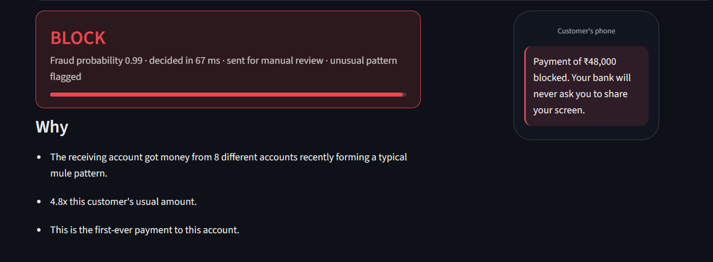

# FraudShield

An explainable fraud-detection system for Indian digital payments that scores a payment in milliseconds and decides whether to approve it, ask for an OTP, or block it.

**Live demo:** [fraudshield-garv.streamlit.app](https://fraudshield-garv.streamlit.app)



---

## The problem

The online fraud incidents have been on a rise recently, especially in India. According to I4C data (as reported), about ₹22,495 crore was lost in 2025 alone. It is hard to detect a fraud since the fraud rate as per the data is ~1.8% here which is rare. Moreover, the scams keep constantly changing. The rules aren't enough since there are many ways where a scam can happen to a consumer.

---

## What the app does

1. **Payment simulator** - Records the user's details about payment mode, usual payment amount, what happened, etc. and gives fraud probability based on the user's input given.
2. **Batch scoring** - Scores a CSV of payments: every row gets a decision, blocked ones go to review queue, and the results are downloadable.
3. **Model performance** - Shows the evidence: threshold/cost trade-offs, unseen-fraud detection, model choice and what drives decisions.

---

## Key results

| Result | Value |
|---|---|
| Test PR-AUC (time-based split) | 0.843 |
| Fraud stopped in the sample batch | 72 of 76 (95%) |
| Cost at the cheapest threshold vs the F1 threshold | ₹1,07,779 vs ₹7,55,186 |
| Unseen malware fraud caught: supervised → + Isolation Forest | 36% → 79% |
| Model choice (rolling 5-fold time-series CV) | GB 0.837 ± 0.031 vs RF 0.832 ± 0.034 |
| Decision Latency including SHAP | ~30-80 ms |

---

## How it works

scenario research → synthetic data (7 fraud groups) → behavioural features → LR/RF/GB → thresholds (cost + F1) → Isolation Forest → SHAP → FastAPI + Streamlit

1. Researched how fraud happens (RBI booklet and news) and grouped them into 7 fraud types.
2. Generated synthetic transactions and built behavioural features.
3. Trained LR/RF/GB and set two thresholds (cost and F1).
4. Added Isolation Forest for fraud types the model never saw.
5. Explained each decision with SHAP and served it through FastAPI and Streamlit.

---

## Design decisions

Time split method was implemented on the model instead of random split because it's how a bank really works (train on the past, predict the future), which was proven when LR drops from 0.74 to 0.35. The model was chosen on validation + rolling CV, never on test. Two thresholds were made in order to block above ~0.93 and step-up OTP above ~0.18 fraud probabilities, respectively. Malware fraud (G6) was held out completely to test the unseen fraud which the model never looked at, this was done in order to test whether the system can catch a fraud type it has never seen, and the Isolation Forest was used to answer that test. SHAP was used for listing the reasons and to find the **ben_fan_in** mule-pattern. The fraud scenarios were built from a case log of RBI and various news reports.

---

## Check on the real-world-style data (PaySim)

The results were calculated based on PaySim data. The transaction-only values were calculated as 0.434, meanwhile, if balances are included, then the values are calculated as 0.999. In PaySim, 97.8% of fraud transactions empty the account completely, so the balance columns give the answer away.

---

## Limitations

1. Trained on synthetic data built from public fraud reports, not real bank data.
2. PaySim's near-perfect scores come from a simulator quirk.
3. A large mule network paid by hundreds of people would look like a shop and slip through.

---

## Run it locally

```bash
pip install -r requirements.txt
python -m src.generate_data
python -m src.train
streamlit run app.py
```

The REST API runs using the following command:
```bash
uvicorn src.api:app
```

---

## Project structure

```
src/          data generation, features, training, API, explanations
app_pages/    the three Streamlit pages
reports/      results and charts
research/     case log and sources
```

---

## Data and credits

1. PaySim is licensed CC BY-SA 4.0: *E. A. Lopez-Rojas, A. Elmir, S. Axelsson, “PaySim: A financial mobile money simulator for fraud detection”, EMSS 2016*
2. Scenario sources are listed in **research/sources.md**

---
